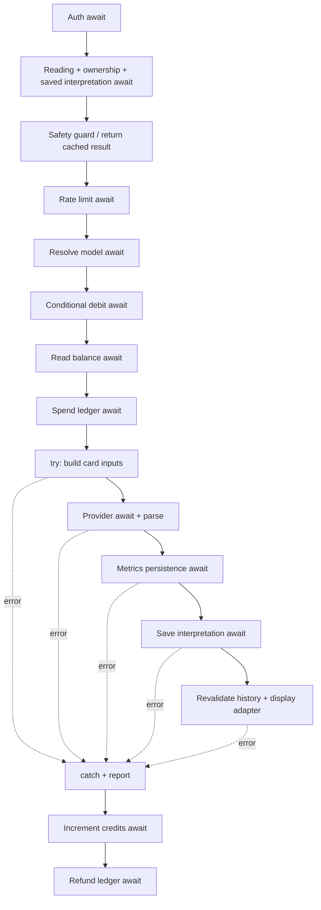
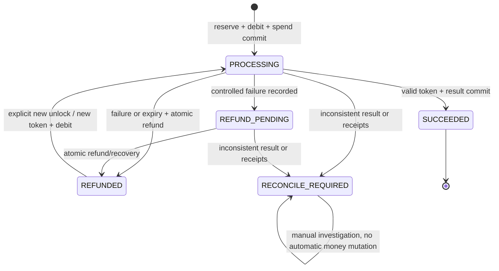

# v7 unlock — Credit, commit point và recovery

Ngày 22/11/2026. **Task 1: hợp đồng đề xuất đã cụ thể hóa; chưa triển khai.** Nhánh `codex/v7-unlock-credit-reliability`, HEAD `81998706a409e2c1278217b8c87c552eef8bb622`. Thiết kế thuộc task list `tasks/tasks-v7-unlock-credit-reliability.md`; không phải xác nhận hệ thống hiện tại đã an toàn.

## 1. Mục tiêu, lựa chọn và phạm vi

Giữ v7, phí 10 credit; không thay prompt/model selection/pricing, payment/top-up/admin-credit policies hoặc nội dung bài. Mục tiêu là không có debit/refund ngoài sổ, không thu tiền lần nữa để đọc bài đã lưu, và có cách settle khi request chết mà catch không chạy.

| Hướng | Đánh đổi | Quyết định đề xuất |
|---|---|---|
| Chỉ bọc try/catch + transaction debit/refund | Nhỏ, đóng lỗi ledger hiện tại | Là bước P0; chưa có durable ownership/recovery |
| Transaction ngắn + một operation row mỗi reading + attempt token + ledger key | Thêm migration nhỏ, chặn request trùng và phục hồi được | Chọn cho hợp đồng đầy đủ |
| Queue/worker + outbox + generic wallet service | Có thể mở rộng nhưng thêm hạ tầng/phạm vi | Không chọn lúc này |

Các lựa chọn kỹ thuật do agent đưa ra trong task 1 để review, chưa áp dụng DB/code. Không tự deploy, migration, gọi API/model, sửa credit lịch sử hoặc cleanup nghiên cứu. Giữ task 0 manifest/hashes làm baseline. Không transaction nào chờ provider hoặc Sentry.

## 2. Luồng hiện tại và điểm có thể lỗi

Source: `app/actions/ai.ts`, `lib/ai/metrics.ts`, providers và `app/actions/readings.ts`.

- Auth/read/rate/model queries trước debit có thể throw nhưng chưa ai mất credit. Card mapping hiện sau debit; cần validate cả count/positions/orientation/IDs trước trừ.
- Debit, balance read và spend ledger nằm ngoài try; ledger/read lỗi sau debit không đi refund. Refund increment/ledger cũng không nguyên tử.
- Metrics vẫn có await; catch của metric gọi reporter, reporter cũng có thể throw. Không coi telemetry là hạ tầng không bao giờ lỗi hoặc luôn nhanh.
- Save có thể thất bại thật hoặc DB đã commit nhưng client nhận lỗi kết nối. Hai trạng thái không được suy ra chỉ từ exception.
- Revalidate/display/reporting là hậu xử lý; hiện nằm trong catch boundary có thể refund bài đã lưu.
- Hai unlock cùng reading có thể cùng đọc chưa có bài, cùng debit và generate; `readingId @unique` chỉ chặn result thứ hai khi save.
- Xóa reading có thể cascade xóa interpretation. Recovery phải phân biệt xóa bài sau success với generation chưa có kết quả; không tự refund mọi reading hiện không có interpretation.

## 3. Invariants bắt buộc

1. Auth/ownership/safety và input validation trước charge/provider; không đủ credit không gọi provider. Không đổi safety policy hoặc thứ tự safety trước trả bài đã lưu.
2. Debit 10 + UNLOCK_SPEND + quyền sở hữu attempt commit cùng một transaction ngắn, hoặc cả ba rollback.
3. Refund 10 + REFUND ledger + terminal REFUNDED commit cùng một transaction, hoặc cả ba rollback. Không refund nếu chưa có debit đã commit của đúng token.
4. Trong cùng attempt, tối đa một spend và tối đa một refund; succeeded attempt net -10, refunded attempt net 0. Sau nhiều retry thất bại rồi một success, net unlock của reading vẫn -10. Không nói tổng credits chỉ bằng unlock ledger vì còn grants/purchases/admin adjustments.
5. Unlock chỉ debit khi credits >=10; không tự làm số dư từ không âm thành âm. Admin/order-refund hiện có thể tạo số dư âm theo chính sách riêng: giữ nguyên, số dư đó không đủ để unlock.
6. Chỉ một attempt PROCESSING/REFUND_PENDING cho mỗi reading. Mỗi attempt được resolve model một lần và ghi model/prompt/cost cố định; không gieo lại random model trong retry transaction.
7. Result và operation SUCCEEDED commit nguyên tử. Sau commit không generation-refund vì cache/UI/metrics/report lỗi, mất response hoặc người dùng xóa history.
8. Worker cũ chỉ được finalize đúng token còn PROCESSING/chưa hết hạn. Refund/recovery CAS cũng gắn token; token cũ không được sửa trạng thái/tiền của token mới.
9. Debit đã commit nhưng chưa có result commit phải được refund hoặc còn durable operation để recovery. Không hứa “đã hoàn” khi DB chưa xác nhận; khi DB unavailable không thể bảo đảm hoàn ngay.
10. Không giữ DB transaction lúc chờ model. Không tuyên bố exactly-once provider execution: timeout/mất kết nối có thể khiến nhà cung cấp đã xử lý. Chỉ bảo đảm settlement theo DB và một worker owner được phép bắt đầu provider cho mỗi token.

## 4. Dữ liệu bền vững nhỏ nhất

### UnlockOperation — một row mỗi reading

Dự kiến thêm model:

- `id` server-generated, `readingId String @unique`, `userId` relation User onDelete Cascade.
- `attemptToken String @unique` do server sinh ngẫu nhiên, thay khi tạo retry sau REFUNDED; client không cung cấp token/amount/userId.
- `status`: PROCESSING / REFUND_PENDING / RECONCILE_REQUIRED / SUCCEEDED / REFUNDED.
- `cost Int`, `model String`, `promptVersion String`: snapshot khi reserve.
- `expiresAt DateTime`: deadline attempt theo clock DB, không heartbeat/gia hạn/worker takeover để tiếp tục generation.
- `interpretationId String?`: dấu vết ID bài sau success; không FK cascade/SetNull làm mất bằng chứng khi history bị xóa.
- `failureCode String?`, `createdAt`, `updatedAt`; chỉ codes có kiểm soát, không exception text hoặc raw question/output.
- Index `(status, expiresAt)` cho recovery.

`readingId` là scalar **không FK vào Reading**, để operation còn tồn tại khi người dùng xóa reading trong lúc attempt chạy. Ownership được kiểm tra qua user/reading trong action/transactions. Không public query operation chỉ bằng reading ID mà bỏ userId. User account bị xóa thì cả credits/ledger/operation cùng thuộc chính sách xóa account hiện có, không cố hoàn vào user đã mất.

Một row được tái sử dụng sau REFUNDED, không thêm bảng attempt history. Ledger giữ lịch sử mỗi attempt qua token keys và relatedReadingId; logs giữ failure codes đã redacted. Không ghi đè/debit lại PROCESSING, REFUND_PENDING, RECONCILE_REQUIRED hoặc SUCCEEDED. RECONCILE_REQUIRED là quarantine bền vững cho result/receipt/token bất nhất, không phải pending có thể tự refund theo expiry. Chấp nhận giới hạn: operation chỉ giữ metadata chi tiết của attempt mới nhất; ledger vẫn giữ các khoản tiền cũ.

### Ledger idempotency

Thêm `CreditTransaction.idempotencyKey String? @unique`:

- `ai-unlock/<attemptToken>/spend` cho UNLOCK_SPEND -cost.
- `ai-unlock/<attemptToken>/refund` cho REFUND +cost.

Legacy/payment/admin rows để null, không backfill keys hoặc gán token suy đoán. Keys chỉ sinh trong server. `relatedReadingId` hiện có giữ nguyên; không thêm relation sang token có thể thay đổi. Migration additive, chưa có yêu cầu rewrite lịch sử hoặc xóa cột.

## 5. Transaction boundaries và tranh chấp

Dùng Prisma transaction ngắn với isolation Serializable cho các mutation operation/credits/result; retry **toàn transaction tối đa 3 lần** chỉ khi lỗi serialization/deadlock Prisma xác nhận retryable và còn deadline. Unique operation creation conflict xử lý bằng rollback rồi đọc authoritative row, không blind retry provider. Không catch bên trong transaction rồi commit phần đã debit. Quyền ownership không chỉ dựa lần read ngoài transaction.

Thứ tự mutation cố định operation → User credits → result/ledger theo nhánh; không thêm transaction đổi thứ tự giữa reserve/refund. Cần DB integration độc lập connections để chứng minh hành vi, không coi mocks chứng minh isolation. Callback transaction không có network/model/metrics; retry DB không được gọi provider thêm.

### A. Preflight

Auth → owned reading/safety → trả bài có sẵn qua adapter → đọc operation đang tồn đọng nếu có → rate-limit cho generation mới → validate reading/cards → resolve model và kiểm tra cấu hình provider không gọi mạng. Các reads có thể fail; chưa reserve thì trả lỗi an toàn, không debit/refund.

### B. Reserve

Trong transaction:

1. Recheck owned reading và bài đã lưu. Bài có sẵn thì trả completed, không tạo attempt hoặc debit.
2. Tạo operation hoặc CAS REFUNDED → PROCESSING với token mới và snapshot. Conflict/row pending thì trả trạng thái hiện tại; không chờ provider trong transaction. SUCCEEDED nhưng result không còn là xóa history/inconsistency, không tự regenerate.
3. Conditional debit credits>=cost; count 0 thì throw sentinel rollback cả operation claim, trả insufficient_credits, không có spend.
4. Đọc credits của chính row trong transaction **sau debit giữ write lock**, ghi balanceAfter và spend ledger key. Commit. Không dùng balance đọc ngoài transaction.

Chỉ worker nhận kết quả reserve committed/owned được phép gọi provider. Nếu commit response mất/timeout, không bắt đầu provider từ kết quả mơ hồ; đọc operation/ledger lại và trả processing/recovery_pending nếu không xác nhận được. Token còn pending sẽ refund khi hết hạn; không để request retry “nhận lại ownership” của token đó để gọi provider.

### C. Generate

Provider chạy ngoài transaction với input đã validate, v7 và model snapshot. Không tự retry generation toàn action hoặc chuyển model vì timeout. Abort provider không có nghĩa provider chưa xử lý; output về muộn không có quyền ghi nếu token hết hạn/refunded/replaced.

### D. Finalize — result commit point

Trong transaction:

1. Khóa operation row trước (SELECT FOR UPDATE hoặc primitive tương đương đã kiểm chứng), rồi kiểm tra userId/attemptToken/status PROCESSING. **Sau khi đã lấy lock**, lấy actual DB wall clock bằng `clock_timestamp()` hoặc tương đương và so `expiresAt` ngay trước transition. Không dùng `now()`/`CURRENT_TIMESTAMP` mang thời gian đầu transaction khi đã chờ lock; không dựa expiry check thực hiện trước lúc bị block.
2. Recheck Reading vẫn tồn tại/thuộc user; tạo AiInterpretation cùng fields/legacy columns hiện có, v7/model/usage snapshot. Nếu reading mất, rollback và đi refund đúng token.
3. Update operation SUCCEEDED + interpretationId trong cùng transaction. Commit là điểm thành công duy nhất, không dựa việc provider trả text.

CAS fail thì đọc authoritative state, tuyệt đối không save/refund token mới. Unique result conflict hoặc commit exception: đọc operation/result/spend/refund để phân biệt thành công đã commit, rollback hay inconsistency. Result tồn tại nhưng token/status không khớp không tự coi đó là bài của token này; rollback finalize chưa commit, rồi dùng transaction kiểm tra riêng khóa operation/result evidence và chuyển RECONCILE_REQUIRED + failureCode nếu xác nhận bất nhất, không “refund mọi unique error”. Nếu DB chưa đọc/ghi được thì response recovery_pending; mọi đường recovery sau đó vẫn phải kiểm tra evidence trước refund.

Sau commit: display adapter/revalidate/metrics/report được bảo vệ riêng; lỗi không gọi refund. Adapter lỗi có thể trả `completed_unavailable` để yêu cầu tải lại lịch sử mà không generation mới. Trả success chỉ khi có DisplayInterpretation hợp lệ của row đã lưu.

### E. Fail/refund

Provider/schema/parse/save lỗi trước success → nếu DB hoạt động, transaction CAS PROCESSING hoặc REFUND_PENDING đúng token → tăng cost → REFUND key → REFUNDED. Nếu đọc thấy SUCCEEDED/REFUNDED thì không cộng thêm. Token không còn current thì không đổi gì.

**Guard bắt buộc ở mọi refund path** (catch, status-triggered, scheduler, manual recovery helper): khóa đúng operation row trước; đọc lại token/status, receipt spend/refund theo keys và kết quả theo readingId trong cùng transaction. RECONCILE_REQUIRED/SUCCEEDED không được increment. REFUNDED chỉ trả receipt, không cộng thêm. Với nonterminal có interpretation tồn tại, receipt thiếu/sai amount hoặc refund receipt đã có nhưng state chưa khớp, không suy đoán rollback: chuyển RECONCILE_REQUIRED trong transaction đó và báo IDs/codes để rà. Không mutate khoản tiền để “sửa” inconsistency. Không có result và có đúng spend chưa refund của token mới được compensate. Kết quả đã bị người dùng xóa sau success vẫn được bảo vệ bởi status SUCCEEDED, không dựa result hiện tại có hay không.

Có thể đánh dấu REFUND_PENDING + failureCode trước thử refund khi DB còn hoạt động; nếu đánh dấu cũng thất bại, PROCESSING đã reserve là durable fallback. Khi refund transaction báo lỗi commit mơ hồ, không increment lần nữa ngay: đọc ledger/status; chưa đọc được thì trả recovery_pending. Chỉ trả refunded khi có terminal REFUNDED và receipt tương ứng đã xác nhận.

## 6. State machine, deadline và fencing

Các transition là CAS gắn user/operation/token/status, không chỉ update theo readingId. REFUND_PENDING và RECONCILE_REQUIRED không thể finalize; quarantine chặn cả reserve mới lẫn automatic refund, kể cả expiresAt đã qua. Thoát quarantine chỉ qua thao tác đối soát có bằng chứng được duyệt riêng ở task 6, không qua nút retry hoặc sửa trực tiếp số dư. Recovery không khởi chạy lại provider. Không dùng lease takeover generation: hết hạn chỉ settle/refund, người dùng chỉ retry với token mới sau REFUNDED. Khi user nhận refunded response, không tự động retry trong nền.

Ngân sách thiết kế ban đầu: action soft deadline **55 giây từ đầu request**, provider tối đa **45 giây và không vượt remaining budget trừ 10 giây** cho DB/settlement. Trước reserve/provider phải còn ngân sách tối thiểu tương ứng, nếu không thì không bắt đầu bước mới. Các giá trị này dựa config 60 giây hiện trong repo, **chưa xác minh deployment**; task 4/8 phải kiểm tra và giảm khi môi trường thấp hơn. Không hứa các thời hạn DB/network luôn giữ được; durable recovery là cơ chế chịu việc process bị cắt.

`expiresAt` dùng clock DB + remaining soft budget tính lúc reserve; so sánh expiry bằng actual DB wall clock **sau khi khóa operation row**, ngay trước transition trong finalize/recovery, không dùng giờ trình duyệt hoặc transaction-start timestamp. Không gia hạn expiry khi metrics chậm. DB transaction timeouts/retries phải nằm trong phần budget còn lại; chi tiết timeout từng query được chốt bằng task 4 và integration tests, không giữ transaction dài bằng thời gian provider.

Recovery đọc batch PROCESSING hết hạn hoặc REFUND_PENDING, rồi CAS/refund từng token trong transaction riêng. Candidate scan không đủ để refund: transaction phải khóa operation rồi kiểm tra lại state/token/expiry bằng actual wall clock và result/ledger guards mục 5E. Không chọn hoặc xử lý RECONCILE_REQUIRED như pending thông thường. Finalize và expiry-refund tranh cùng operation row; chỉ một nhánh được commit. Worker đã bị refund không thể save muộn hoặc refund attempt mới. Nếu refund chưa settle vì DB unavailable, user chưa được tạo attempt mới cho reading đó.

Kích hoạt recovery từ scheduler riêng có auth; authenticated unlock/status lookup có thể settle chính operation hết hạn của user để giảm chờ, không quét người khác. Scheduler deployment/interval thuộc task 4, chưa tự thêm cron vào production. Release đầy đủ bị chặn nếu không có cơ chế được vận hành để drain pending dù người dùng không quay lại. Không dùng cron PayOS hiện có cho unlock recovery.

## 7. Contract action/UI

Giữ `ok:true/data` và nhánh safety hiện có; các lỗi có code/state thay vì thông báo mơ hồ:

| Kết quả | Hành vi UI |
|---|---|
| completed + data | Hiện bài đã lưu, refresh credit; không generate lại |
| processing | Báo đang xử lý, khóa generation retry cho reading; nút kiểm tra trạng thái/tải lại không debit |
| reconciliation_required | Báo cần đối soát trạng thái, chặn generation retry; không hứa thời điểm hoàn hoặc tự sửa tiền |
| recovery_pending | Báo trạng thái credit đang được đối soát, chưa xác nhận hoàn; không mời retry generation |
| refunded | Báo lần này không thành công và credit đã hoàn sau khi xác nhận; cho explicit retry token mới |
| completed_unavailable | Bài đã lưu nhưng chưa hiển thị được; mời tải lại history, không nói generation failed |
| insufficient_credits | Không có debit/provider; hiển thị thiếu credit |
| denied / invalid / rate_limited / unavailable | Không tiết lộ reading người khác; không khẳng định credit đã thay đổi nếu chưa có receipt |

Dự kiến error union `{ok:false,error:string,code:<enum>,retryable:boolean}` ngoài support branch; processing/recovery/reconciliation/completed_unavailable retryable=false cho **generation**, có thể status lookup riêng. `getUnlockStatusAction(readingId)` chỉ đọc/settle operation đúng user, không gọi provider hoặc reserve debit mới. Nếu reading bị xóa, không trả prose cũ; chỉ trả settlement state của chính user khi có operation hợp lệ. UI không poll tự động vô hạn, không tin isPending làm concurrency guard. Không đổi nội dung prompt/giá.

## 8. Ma trận lỗi → trạng thái → ledger → UI

| Điểm lỗi/tình huống | Trạng thái authoritative | Ledger/số dư | Response/recovery |
|---|---|---|---|
| Auth/ownership/safety/rate/input/model config trước reserve | Chưa attempt mới | Không spend/refund | Denied/support/invalid/rate/unavailable |
| Không đủ credits | Claim rollback | Không đổi | insufficient_credits, không provider |
| Debit/read balance/spend ledger fail trong reserve | Toàn tx rollback hoặc commit mơ hồ phải đọc lại | Không có debit thiếu ledger | unavailable hoặc processing/recovery_pending nếu chưa xác nhận |
| Hai request cùng reading | Một token owner, còn lại đọc state | Một reservation active | processing/completed, không gọi provider thứ hai |
| Hai reading cùng tranh 10 credit cuối | Một reservation commit | Một spend; không âm do unlock | Lượt còn lại insufficient |
| Provider key/rejection/timeout/schema/parse lỗi | PROCESSING → REFUND_PENDING/REFUNDED | Refund đúng token nguyên tử | refunded khi receipt xác nhận, nếu không pending |
| Process chết sau reserve hoặc sau provider trước save | PROCESSING tới expiry | Debit có spend; sau recovery net 0 | Không dựa catch; recovery refund |
| Save chắc chắn rollback / reading bị xóa trước finalize | Không result commit | Refund hoặc pending recovery | refunded/pending; không bài mồ côi |
| Save/finalize commit nhưng response mất | SUCCEEDED + interpretationId | Net -10 | Retry/status trả completed, không refund |
| Finalize commit không rõ vì lỗi kết nối | Chưa biết tại caller | Không đoán rollback | Read authoritative rows; DB chưa đọc được thì recovery_pending |
| Revalidate/adapter/report/metric lỗi sau commit | SUCCEEDED giữ nguyên | Net -10 | completed hoặc completed_unavailable; không refund |
| Refund ledger/increment lỗi | Toàn refund tx rollback hoặc commit mơ hồ | Không refund ngoài ledger | Pending; kiểm tra receipt trước retry |
| Recovery/catch chạy lặp | CAS terminal/token chặn | Tối đa một refund key | Đọc terminal state |
| Worker cũ trả về sau expiry/refund/new attempt | Token/state guard fail | Không đổi tiền attempt mới | Bỏ output, đọc state; không save muộn |
| History bị xóa sau success | Operation vẫn SUCCEEDED | Không tự refund | Không regenerate/refund vì hành động xóa của user |
| Unique result hoặc receipt/token không khớp | RECONCILE_REQUIRED khi xác nhận được dưới lock | Không suy receipt hoặc increment | reconciliation_required + alert IDs, mọi automatic refund bị chặn; DB chưa xác nhận thì pending |
| DB unavailable kéo dài | Durable row/receipt còn từ lần commit trước | Không bảo đảm hoàn ngay | Pending tới khi DB phục hồi; cảnh báo vận hành |

## 9. Migration, legacy và giới hạn rollout

Bắt buộc cho hợp đồng đầy đủ: UnlockOperation, trạng thái/token/deadline và unique nullable ledger idempotency key. Migration additive giữ mọi ledger/interpretation cũ, không gán operation cho bài legacy dựa trên suy đoán. Cached legacy trả như hiện tại không debit; không validate lại body cũ bằng schema mới.

Không tự sửa historical mismatches. Đối soát lịch sử read-only/dry-run với những chứng cứ còn có, case không rõ phải được rà thủ công ở task 6. Không reset số dư từ tổng unlock ledger hoặc coi amount REFUND đơn PayOS âm là lỗi unlock.

Code cũ không biết operation có thể tạo debit không có receipt hoặc bỏ qua fencing. Vì vậy không rollout đồng thời old/new financial writer khi bắt đầu durable protocol. Cần cutover/drain hoặc feature gate server-side cho unlock generation mới, giữ read/history/status/recovery của protocol mới hoạt động. Rollback không được chỉ quay về action cũ trong khi còn pending; trước tiên dừng reserve mới và drain/reconcile, hoặc giữ compatible settlement/recovery code. Các bước cutover/rollback cụ thể là release task 8, chưa thực hiện.

P0 task 2 có thể triển khai atomic debit/refund và tách post-commit boundary trước schema, nhưng không phát hành như giải pháp đầy đủ concurrency/crash-safe. Nếu thực hiện theo nhiều commits, tiếp tục chặn release cho tới task 3/4/DB proofs hoàn tất. Không áp attempt keys của thiết kế vào schema chưa migrate rồi tự tuyên bố durable.

## 10. File plan và kiểm chứng cần có

| Nhóm | File và trách nhiệm |
|---|---|
| Transaction helpers | `lib/ai/unlock-credit.ts`, unit/integration tests: reserve/finalize/refund/status; nhận db dependency theo pattern admin hiện có, không generic wallet framework |
| Orchestration | `app/actions/ai.ts`, `lib/ai/unlock.test.ts`: guards, generation ngoài tx, outcome/commit boundary, không blind action retry |
| Durable schema | `prisma/schema.prisma`, additive migration: operation/unique ledger key; DB tests độc lập connections |
| Deadline | `lib/ai/generate.ts`, `gemini.ts`, `deepseek.ts`, `metrics.ts`, tests: remaining signal/bounded telemetry, không đổi prompt/model selection |
| Recovery | `lib/ai/unlock-recovery.ts` + tests, endpoint cron riêng có auth khi task 4: batch conditional refund, không provider |
| Display/history | `AiUnlockPanel.tsx`, actions/readings/history và tests: result codes/status, deletion, legacy; không redesign |
| Evidence/runbook | Task 6/8 report, dry-run/release/rollback instructions, logs chỉ IDs/codes |

Test bắt buộc: reserve ledger fail rollback; refund ledger fail rollback; success-save rồi revalidate/adapter/report fail không refund; commit ambiguity reads; concurrent same/different reading; duplicated refund; stale-token race/expiry; user deletion/history deletion; metrics delay; provider abort; legacy cached result; end-to-end retry sau mất response. DB rollback/isolation phải có real PostgreSQL test, không chỉ mocks; mọi financial writes gắn expected token/status và idempotency key.

Lượt task 1 chỉ đọc code/viết thiết kế, không sửa source/schema hoặc chạy DB/provider. Baseline gần nhất task 0 là 94 focused tests, lint/typecheck đạt; không chạy lại tests cho tài liệu thuần. Trước sửa implementation đọc Next.js installed docs và chuyển characterization gap tests thành RED→GREEN cho hành vi mới. Code/API availability cần kiểm tra bằng types/client cài tại implementation, không dựa vào phiên bản Prisma giả định.

## 11. Điểm dừng

Task 1 kết thúc bằng thiết kế + matrix + builder check, không tự triển khai task 2. Invariants/contract được chốt thành đề xuất reviewable; chưa phải bằng chứng đã đảm bảo tiền. Trước implementation cần người dùng duyệt thiết kế; nếu tiếp tục, lập bước triển khai P0 theo phạm vi task 2 và giữ nguyên release blockers của durable protocol.

## 12. Builder check và quyết định đã xử lý

Reviewer độc lập phát hiện hai mâu thuẫn có thể ảnh hưởng tiền: case cần reconcile vẫn có thể bị expiry recovery hoàn tự động; expiry dùng transaction-start clock có thể cũ sau lúc chờ lock. Đã chốt **RECONCILE_REQUIRED** là quarantine bền vững, mọi refund path khóa row và kiểm tra result/spend/refund evidence trước mutation. Đồng thời yêu cầu actual DB wall clock sau lock, không `now()`/CURRENT_TIMESTAMP trước chờ. Đây là thiết kế đã sửa theo review, chưa phải bằng chứng DB tests đã đạt.

Task 1 đủ tài liệu để lập implementation plan cho task 2 khi được duyệt. Chưa chạy tests/schema migration/provider/DB, không đổi source so với pins task 0. Quarantine thủ công và scheduler recovery là điều kiện release, không được âm thầm hoãn rồi báo crash-safe.

## Cập nhật task 3 — 23/11/2026

Durable protocol và additive migration đã triển khai trên nhánh, chưa production. Expiry dùng native timestamptz(3) để không phụ thuộc DB session timezone; raw SQL serialization/deadlock rollback được retry tối đa ba lần. Bằng chứng và phạm vi: `docs/v7-unlock-credit-task3-result-2026-11-23.md`. 739 tests passed/4 skipped gồm 18 real DB tests; legacy-upgrade/schema proof đạt. Task 4 còn end-to-end deadline và recovery scheduler; không coi 55s operation lifetime hiện tại là request deadline hoàn chỉnh hoặc được phép mixed old/new writers.
